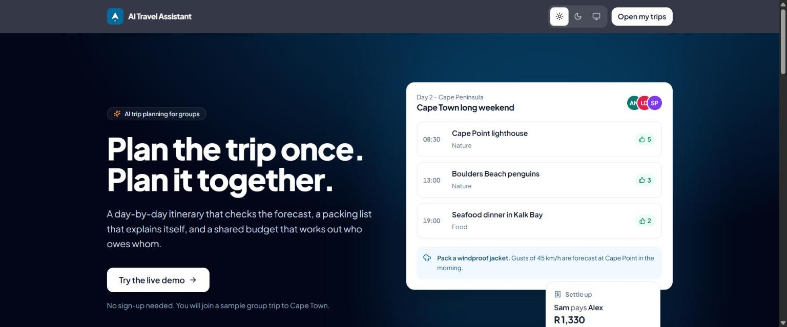
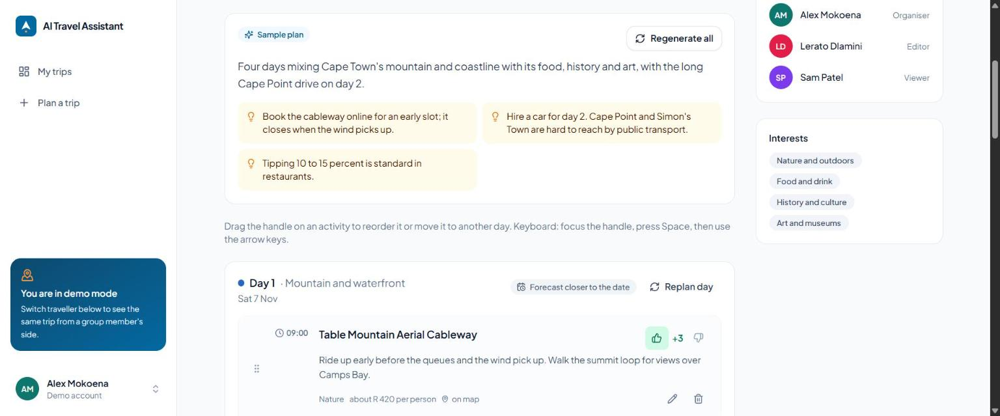
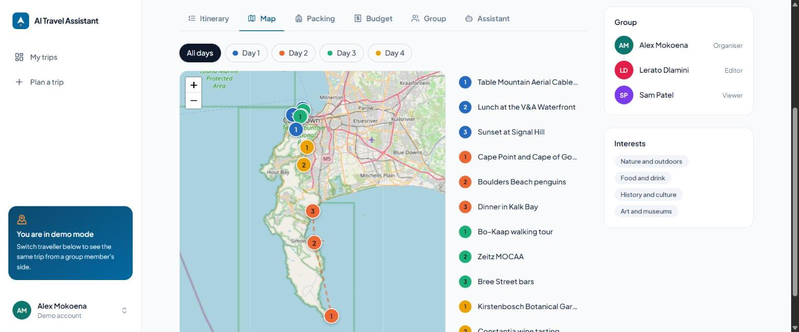
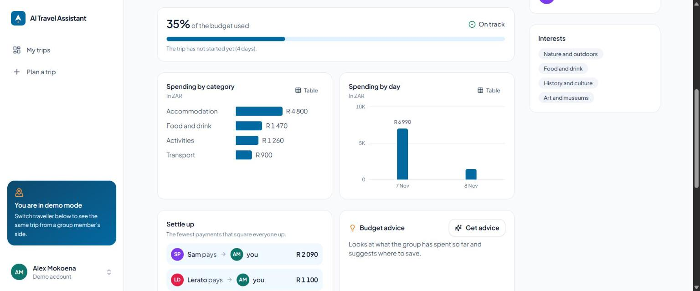
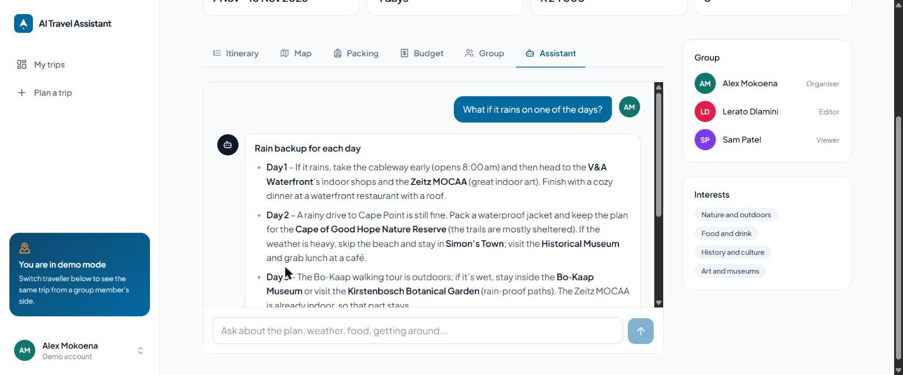
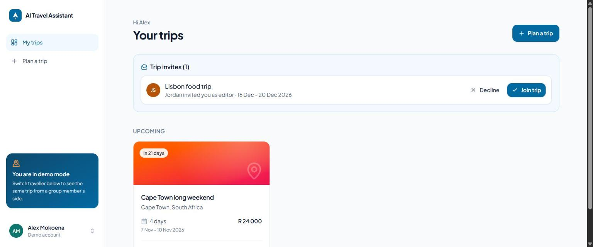
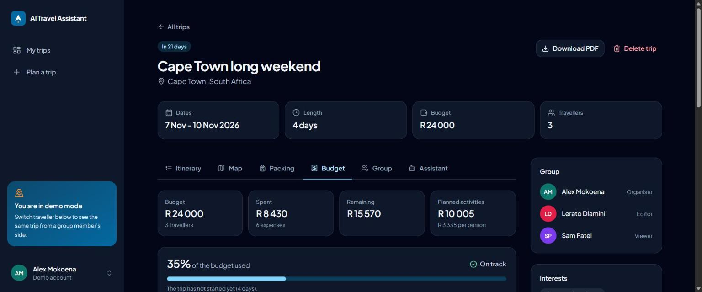

# AI Travel Assistant

[](https://github.com/TeekayVuyisile/AI-Travel-Planner/actions/workflows/ci.yml)

A group trip planner that builds a day-by-day itinerary around the weather forecast, writes a packing list that explains every item, and keeps a shared budget that works out who owes whom.



## Features

- **AI itineraries that read the forecast.** Groq generates a day-by-day plan from the destination, dates, budget and interests. Days with a real forecast get rain- and wind-aware choices; later days use typical conditions for the month instead of invented numbers.
- **Places checked against the map.** Every AI-suggested activity is looked up on OpenStreetMap near the destination. Confirmed places get exact pins; anything unconfirmed is shown as an approximate location rather than a confident guess.
- **Packing lists with reasons.** Shared and personal items, each with the reason it is there ("Type M plugs", "45 km/h gusts at Cape Point on day 2").
- **Group planning.** Invite people by email as editors or viewers, vote activities up or down, and replan a single day (downvoted activities are replaced).
- **Shared expenses and settle-up.** Log costs in any currency, split evenly or by amount, and see the fewest payments that square everyone up. Charts and a budget meter show progress, with AI budget advice.
- **Trip assistant.** A streaming chat that knows the itinerary, forecast, budget and packing list, shared by the whole group.
- **Map, editing and export.** Leaflet map per day, drag-and-drop editing (mouse and keyboard), and a PDF of the itinerary and packing list.
- **Weather alerts.** The dashboard flags outdoor plans on days the forecast turns rough.
- **Try it without signing up.** "Try the live demo" signs in as a traveller in a seeded group trip; switch traveller to see the same trip as an editor or a viewer.
- **Dark mode and accessibility.** Light, dark or system theme; keyboard support throughout; checked with axe-core in both themes.

| Itinerary | Map |
|---|---|
|  |  |

| Shared budget | Trip assistant |
|---|---|
|  |  |

| Dashboard | Dark mode |
|---|---|
|  |  |

## How it works

```
web/ (React 19, Vite, Tailwind CSS v4, TanStack Query)
  |  /api
backend/ (Express, PostgreSQL)
  |-- planService ----- weather (OpenWeatherMap) + places (OpenTripMap) + city centre (Nominatim)
  |       |-- aiService (Groq, strict JSON schemas) -- falls back to a rule-based planner
  |       '-- refineCoordinates (Photon / OpenStreetMap) -- verified vs approximate pins
  |-- budgetService / settlementService -- currency conversion, integer-cent splits, settle-up
  '-- alertService -- rough weather on days with outdoor plans
```

Design choices worth knowing:

- **Every external service has a fallback.** Without a Groq key the rule-based planner takes over and the assistant explains it is off; weather, places and currency fall back to offline data that is never presented as real (mock weather is not shown as a forecast). The demo keeps working when an API is down.
- **Structured AI output.** Groq is called with strict JSON schemas, then validated again (times, categories, costs, coordinates within range of the destination).
- **Group access.** Trips belong to members with owner, editor or viewer roles; non-members get a 404 so trip ids are not revealed.
- **Money in cents.** Splits always add up exactly to the converted total, and settle-up clears every balance in at most n - 1 payments.

## Tech stack

- **Frontend:** React 19, Vite, Tailwind CSS v4, React Router, TanStack Query, Leaflet, dnd-kit, react-pdf, react-icons (Lucide)
- **Backend:** Node.js 22, Express, PostgreSQL 17 (raw SQL with numbered migrations), JWT auth, express-validator
- **AI and data:** Groq (`openai/gpt-oss-120b` for planning, `openai/gpt-oss-20b` for chat), OpenWeatherMap, OpenTripMap, ExchangeRate-API, Photon and Nominatim (OpenStreetMap)
- **Testing:** node:test and supertest (backend), Vitest and Testing Library (web), GitHub Actions CI

## Getting started

Prerequisites: Node.js 22, PostgreSQL 14 or later.

```bash
git clone https://github.com/TeekayVuyisile/AI-Travel-Planner.git
cd AI-Travel-Planner
```

1. Create an empty PostgreSQL database named `ai_travel_planner`.

2. Backend:

   ```bash
   cd backend
   npm install
   cp .env.example .env    # fill in the database settings and API keys
   npm run migrate         # create or update the tables
   npm run seed            # demo travellers and a sample group trip
   npm run dev             # http://localhost:5000
   ```

3. Web app, in a second terminal:

   ```bash
   cd web
   npm install
   npm run dev             # http://localhost:5173, /api is proxied to the backend
   ```

Open http://localhost:5173 and choose **Try the live demo**.

### Environment variables (backend)

| Variable | Needed for |
|---|---|
| `DATABASE_URL` or `DB_HOST`, `DB_PORT`, `DB_NAME`, `DB_USER`, `DB_PASSWORD` | Database (a connection string takes precedence) |
| `JWT_SECRET`, `JWT_EXPIRES_IN` | Sign-in tokens |
| `CLIENT_URL` | CORS: the web app's URL |
| `GROQ_API_KEY` | AI itineraries, packing lists, budget advice and the assistant (optional: falls back without it) |
| `GROQ_MODEL`, `GROQ_CHAT_MODEL` | Optional model overrides |
| `OPENWEATHER_API_KEY` | Live weather and forecasts (optional) |
| `OPENTRIPMAP_API_KEY` | Candidate places for the planner (optional) |

The web app reads `VITE_API_URL` (default `/api`).

## Tests

```bash
cd backend && npm test   # 40 tests: settle-up maths, permissions, expenses, invites, AI fallbacks
cd web && npm test       # 16 tests: formatting, markdown rendering, chart accessibility, autocomplete
```

Backend tests run against a separate `ai_travel_planner_test` database that is created and reset automatically, with external APIs switched off. CI runs both suites, the linter and a production build on every pull request.

## Deployment

The app is three parts: a PostgreSQL database, the Express API and the static web app. One way to host it on free tiers:

1. **Database (Neon).** Create a project and copy the connection string (it includes `?sslmode=require`).
2. **API (Render, Web Service).**
   - Root directory: `backend`
   - Build command: `npm ci`
   - Start command: `npm run migrate && npm start`
   - Environment: `DATABASE_URL`, `JWT_SECRET`, `JWT_EXPIRES_IN=7d`, `CLIENT_URL` (the web app's URL), `GROQ_API_KEY` and the optional API keys
   - After the first deploy, create the demo travellers once by running `npm run seed` with `DATABASE_URL` set to the hosted database (from your machine, or the service shell where available). Re-run it to reset the demo.
3. **Web app (Vercel).**
   - Root directory: `web`, framework preset Vite (build `npm run build`, output `dist`)
   - Environment: `VITE_API_URL=https://<your-api>.onrender.com/api`
   - `web/vercel.json` rewrites all routes to `index.html` so deep links such as `/trips/42` load.

Free Render services sleep when idle, so the first request after a quiet period can take around a minute.

## Project structure

```text
backend/
  config/       database pool and migration runner
  middleware/   auth, trip roles, AI rate limits
  migrations/   numbered SQL migrations
  models/       SQL models
  routes/       API endpoints
  services/     AI planning, budget and settle-up, weather, places, currency, alerts
  scripts/      migrate and seed
  tests/        node:test suites
web/
  src/
    components/ UI, layout, charts and trip workspace (itinerary, map, packing, budget, group, assistant)
    contexts/   auth and toasts
    lib/        API client, formatting, theme, trip helpers
    pages/      routes
docs/screenshots/
```

## Author

Teekay Vuyisile Manale
